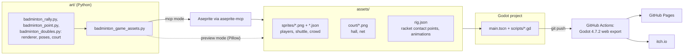
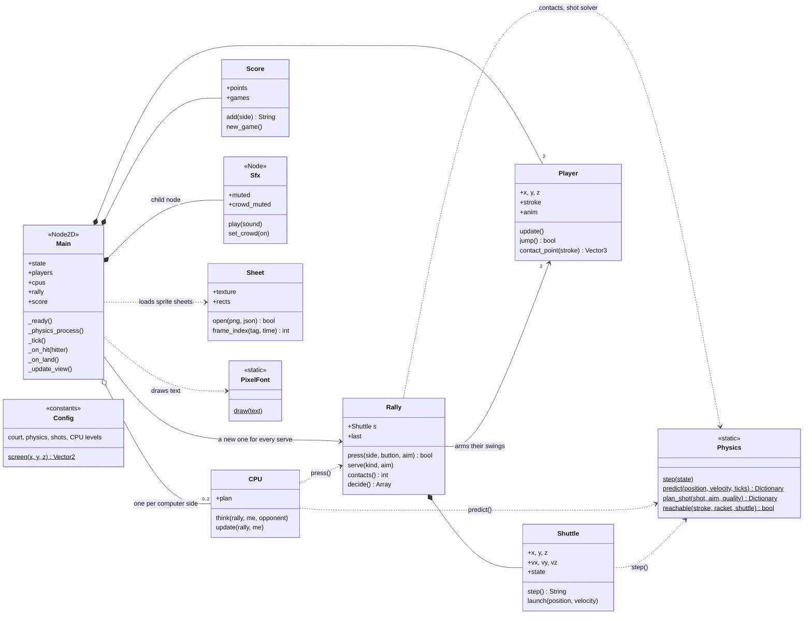
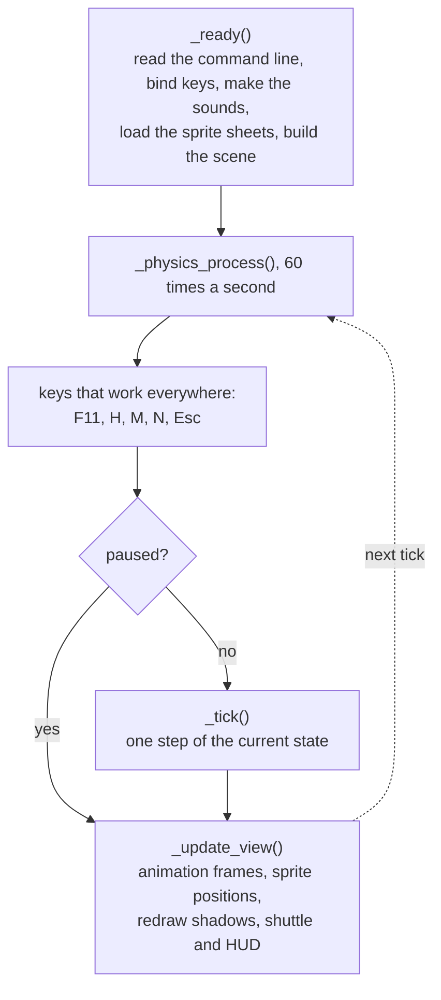
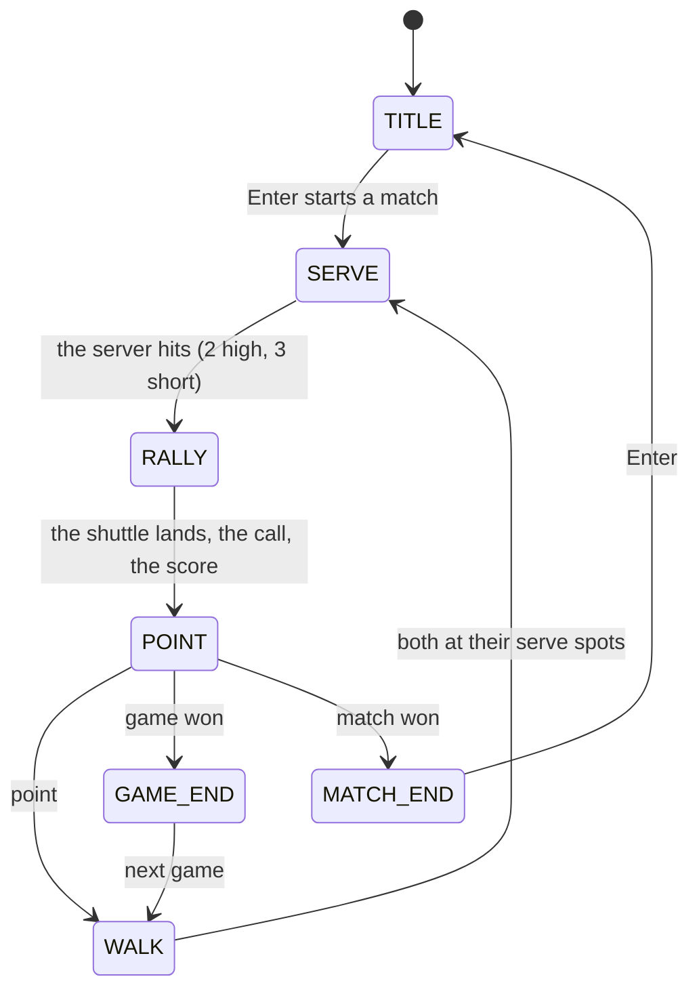
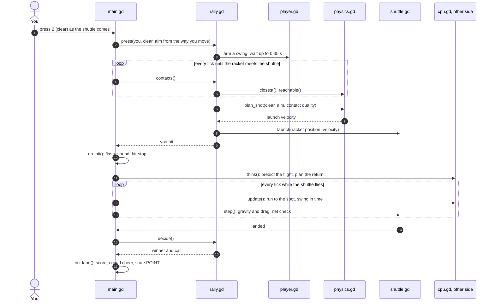
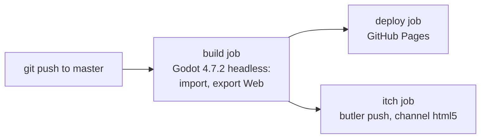

# How the game works

This page explains how the code fits together, for someone who programs but
hasn't used Godot. The diagrams are [Mermaid](https://mermaid.js.org/); GitHub
draws them when you view this file.

## Godot in two minutes

- A Godot game is a tree of **nodes**, and a node can have a script. This game
  has one scene, `main.tscn`, with one `Node2D` called *Main* that runs
  `scripts/main.gd`. At start-up that script adds the nodes it draws with
  (sprites and drawing layers) and the sound node.
- Every other script `extends RefCounted`: a plain object, freed by reference
  counting when nothing refers to it any more (like a Java object, without a
  garbage collector). `main.gd` creates them with `.new()` and calls them.
- `const Rally := preload("res://scripts/rally.gd")` works like an `import`;
  `res://` is the project folder.
- Godot calls `_ready()` once at start-up and `_physics_process()` 60 times a
  second. One call is one **tick**; all game logic counts in ticks.
- The screen is 192 × 108 pixels, scaled up by whole numbers (960 × 540 in a
  window) so the pixel art stays sharp.

## The whole picture

The art is drawn by Python scripts, either in Aseprite (through aseprite-mcp)
or with Pillow; both write the same files into `assets/`. The sounds aren't
files at all: `sfx.gd` synthesizes them when the game starts.

## The scripts

Every script also reads its numbers from `Config`; those arrows are left out.

| File | In the diagram | What it does |
|---|---|---|
| `scripts/main.gd` | Main | The only script on a scene node: game states, keyboard and gamepad, creating everything else, drawing, the HUD, the self-test mode |
| `scripts/rally.gd` | Rally | The rules of one rally: arming swings, finding the contact, launching the shot, the call |
| `scripts/shuttle.gd` | Shuttle | Where the shuttle is and how it moves: held, in flight, falling from the net, landed |
| `scripts/physics.gd` | Physics | Static maths: flight with gravity and air drag, predicting a flight, the shot solver, the reach rules |
| `scripts/player.gd` | Player | One player: running, jumping, the current swing, which animation frame to show |
| `scripts/cpu.gd` | CPU | The computer player: predicts the flight, plans the return, runs there, swings |
| `scripts/score.gd` | Score | 3 × 15 scoring: games to 15, two clear points from 14-all, 21 at most; best of three |
| `scripts/config.gd` | Config | Every number (court, physics, shots, CPU levels) and the court-to-screen projection |
| `scripts/sheet.gd` | Sheet | Loads an Aseprite sprite sheet (PNG + JSON) and finds a frame by animation tag and time |
| `scripts/pixel_font.gd` | PixelFont | The 3 × 5 pixel font of the HUD |
| `scripts/sfx.gd` | Sfx | All sounds, synthesized at start-up: hits, net, landing, beeps, the crowd |

## One tick

`_tick()` runs the function of the current state (`_title_tick()`,
`_serve_tick()`, `_rally_tick()` and so on). In the self-test mode it runs
several ticks per frame to play faster.

## Game states

The states are the `St` enum in `main.gd`. Pausing (Esc) isn't a state, just a
flag that stops `_tick()`; Q on the pause screen goes back to `TITLE`. A rally
serves from the right court on an even score and the left on an odd one,
diagonally, like the real game.

## One shot, step by step

The ideas behind it:

- **A button arms a swing; it doesn't hit at once.** The swing waits up to 0.35 s
  (21 ticks). Each tick `Rally.contacts()` checks whether the shuttle's path
  passes within 9 px of the racket head of any stroke the player could play
  (overhead, kill, drive, block, net shot, lift; in the air only the jump smash).
  The closest one is the stroke you see.
- **The button picks the shot for that stroke** (`SHOT_MAP` in `config.gd`):
  2 = clear (a lift when the shuttle is low), 3 = drop (net shot or block),
  4 = smash (drive, kill or push). The direction you move while hitting aims it.
- **`Physics.plan_shot()` solves for the launch velocity.** The shot must reach
  its target depth, clear the tape by its margin and stay under its speed and
  height limits; then the hitter's error is added, larger for a poor contact or
  an easier computer level.
- **The shuttle flies with gravity and air drag** (250 px/s², drag 0.016 per
  px), two sub-steps per tick. Crossing the net below the tape (28 px) drops it
  at the net.
- **The call** (`Rally.decide()`): NET if it didn't get over, OUT beyond the
  baseline or the singles sideline, SHORT SERVE or SERVICE FAULT (wrong service
  court) for serves, otherwise IN.
- **The computer** (`cpu.gd`) plans the moment you hit: it predicts the flight
  400 ticks ahead, lets shuttles go that will land out (how reliably depends on
  the level), finds where each stroke could meet the shuttle after its reaction
  time, prefers kill > jump smash > overhead > drive > net shot > block > lift,
  and aims away from you. Then it runs there and presses a few ticks before the
  contact. Easy, Normal and Hard (`LEVELS` in `config.gd`) differ in speed,
  reaction time (0.30 / 0.20 / 0.13 s), errors and judgement.

## Drawing

The court is 3D in the code: **x** along the court (net at 96, baselines at 12
and 180), **y** across it (0 = centre line, + towards the camera, singles
sidelines at ±32.4) and **z** = height. `Config.screen(x, y, z)` turns that into
a pixel on the oblique court of the animations:
row = 85 + y × 9 / 32.4, then screen = (x + (88 − row) × 0.5, row − z).

Players and the net are sprites showing one frame of a sheet; the shadows, the
shuttle and the HUD are drawn with draw calls on their own layer nodes, every
frame. Back to front:

| Layer (z) | What |
|---|---|
| 0 | the hall (background image) and the crowd (an animated sheet) |
| 1 | shadows |
| 2 or 4 | the shuttle on red's side, behind or in front of red by depth |
| 3 | red player |
| 5 | the net |
| 6 or 8 | the shuttle on blue's side |
| 7 | blue player |
| 10 | HUD: score, key bar, messages, title menu |

From this camera the net always covers red and is always covered by blue, so a
fixed order works.

## Build and publish

All three jobs are in `.github/workflows/pages.yml`. `tools/export.sh` builds
the same web version, plus Linux and Windows, on your own machine (see the
[README](README.md#sharing-the-game-browser-linux-windows)).

## Where to change what

| To change | Look in |
|---|---|
| Keys, mouse and gamepad | `_setup_input()`, `_human_input()`, `_unhandled_input()` (which device was used last) and the `_mouse_…` functions in `main.gd`; the hints in `_labels()`, `_draw_keys()` and `_draw_title()` |
| Speeds, shots, gravity, computer levels | `config.gd` (tuned with `tools/sim.py`, which uses the same names) |
| Rules and calls | `decide()` in `rally.gd`, and `score.gd` |
| How the computer plays | `cpu.gd`, and `LEVELS` in `config.gd` |
| Pictures | `art/badminton_game_assets.py`, then draw the assets again ([README](README.md#redrawing-the-art-in-aseprite)) |
| Sounds | `sfx.gd` |
| HUD and texts | `_draw_hud()` and the functions after it in `main.gd`; letters in `pixel_font.gd` |
| Publishing | `.github/workflows/pages.yml` |

To check a change without playing, run the [self-test](README.md#self-test-computer-against-computer): the
computer plays itself for 40 points, prints a report and fails if something
looked wrong.
